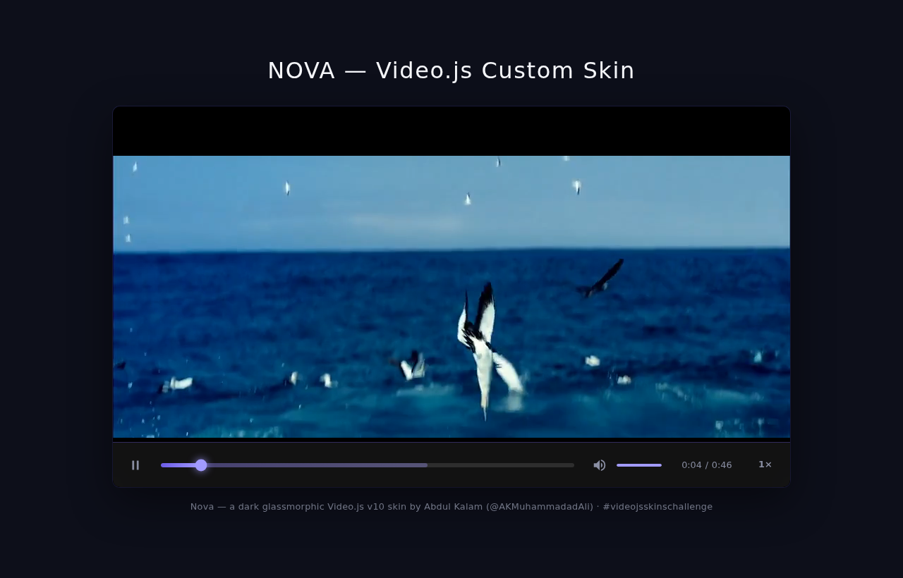

# Nova: a dark glassmorphic Video.js skin

Nova is a custom skin for **Video.js 10** (`@videojs/html` 10.3.0), playing a **Mux** HLS stream. It's my entry for the Video.js Skins Design Challenge (Contra x Mux).

- **Live demo:** https://hark.com/site/8c015edc-226e-43c4-87fc-46cc262e38d1?hark_region=us
- **Contra entry:** https://contra.com/community/oKoTUrLz-dark-glassmorphic-videojs-skin-with-mux



## Design

- A frosted-glass control bar floating over the video
- A violet gradient progress fill with a glowing scrubber
- A dark, low-glare palette that keeps the focus on the picture
- A bar that shrinks on small screens (64px down to 52px)

Design tokens (CSS custom properties):

| Token | Value |
|---|---|
| `--nova-bg` | `#0d0f1a` |
| `--nova-accent` | `#6c5ce7` |
| `--nova-glass` | `rgba(255,255,255,.07)` |
| `--nova-text` | `#f5f6fa` |
| `--nova-muted` | `#8a8fa3` |

## Features

- Built on genuine Video.js 10 web components (`media-*` elements from `@videojs/html`), not the legacy v8 API
- Mux HLS playback, with an MP4 fallback
- Play/pause, a time slider with a buffered range, time display, mute, volume, playback speed and fullscreen
- A buffering indicator, a poster image, and an accessible error dialog
- A screen-reader status announcer and visible keyboard focus
- Tap and click gestures

### Keyboard shortcuts

| Key | Action |
|---|---|
| Space / K | Play or pause |
| M | Mute |
| F | Fullscreen |
| ← / → | Seek back or forward |
| ↑ / ↓ | Volume |
| > / < | Speed up or slow down |

## Files

- `index.html`: the self-contained demo, with the skin, the markup and the bundled player in one file
- `src/entry.js`: the list of `@videojs/html` components the bundle imports
- `src/template.html`: the skin's markup and CSS before bundling
- `src/nova.bundle.js`: the bundled classic-script build of `@videojs/html` 10.3.0
- `screenshots/`: idle, playing, keyboard-focus and mobile views

## Run it

Open `index.html` in a browser. No build step or server is needed.

To rebuild the bundle, install the package and bundle `src/entry.js` as an IIFE:

```bash
npm i @videojs/html@10.3.0 esbuild
npx esbuild src/entry.js --bundle --format=iife --minify --outfile=src/nova.bundle.js
```

## Notes

Tested in Chromium. It hasn't been tested on Safari, Firefox or phones yet. The video is Mux's public test stream.

Made by Abdul Kalam ([@AKMuhammadadAli](https://x.com/AKMuhammadadAli)).
